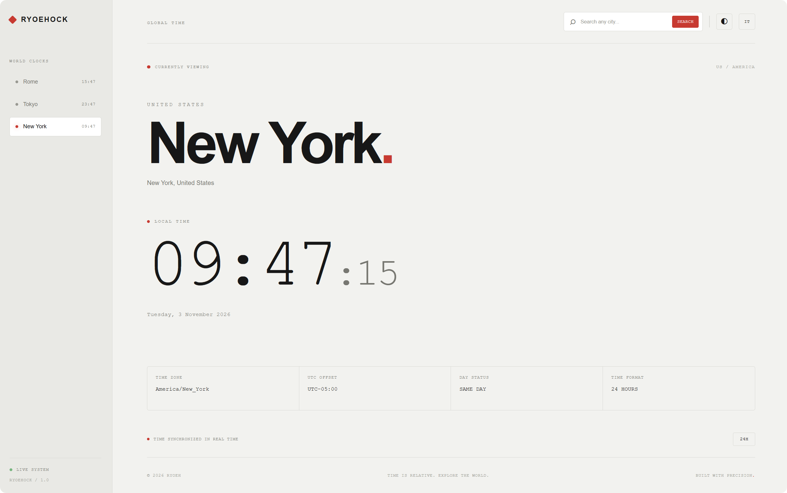

# Ryoehock

A modern, minimal world clock designed to explore time around the world.

Ryoehock lets you search for cities worldwide, discover their local time zones, and display their current time through a clean interface inspired by Nothing OS.

## Preview

<p align="center">
  
</p>

## Features

- **Global City Search** — Search for cities worldwide using geocoding.
- **Automatic Time Zones** — Automatically detects the selected city's time zone.
- **Real-Time Clock** — Displays hours, minutes, and seconds, updated every second.
- **World Clock Sidebar** — Quickly switch between saved cities.
- **Dark & Light Themes** — Switch between two interface themes.
- **Multilingual Interface** — English and Italian language support.
- **12/24-Hour Format** — Choose your preferred time format.
- **Persistent Preferences** — Saves selected cities, theme, language, and clock format using Local Storage.
- **Responsive Design** — Optimized for desktop and mobile devices.
- **Day Comparison** — Indicates whether the selected city is on a different calendar day from your local time.

## Technologies

| Technology | Purpose |
|---|---|
| HTML5 | Application structure |
| CSS3 | Styling and responsive layout |
| JavaScript | Clock logic and application functionality |
| Open-Meteo Geocoding API | City search and time zone identification |
| Intl.DateTimeFormat | Local time and date formatting |
| Local Storage | Persistent user preferences |

## Project Structure

```text
ryoehock/
│
├── index.html
├── styles.css
├── script.js
│
├── assets/
│   └── favicon.svg
│
├── README.md
└── LICENSE
```

## Getting Started

### 1. Clone the repository

```bash
git clone https://github.com/Ryoeh/ryoehock.git
```

### 2. Open the project

```bash
cd ryoehock
```

### 3. Run the application

Open `index.html` in your browser.

Alternatively, use the VS Code Live Server extension.

No installation or build process is required.

## API

Ryoehock uses the free [Open-Meteo Geocoding API](https://open-meteo.com/en/docs/geocoding-api) to search for cities and retrieve geographical information, including their IANA time zones.

Time calculations are handled locally by the browser using JavaScript's `Intl.DateTimeFormat` API.

An active internet connection is required for city searches.

## Browser Compatibility

Ryoehock uses modern JavaScript features and browser APIs.

For the best experience, use an up-to-date version of:

- Google Chrome
- Mozilla Firefox
- Microsoft Edge
- Safari

## License

This project is licensed under the **Ryoeh Proprietary License v1.2**.

All rights not expressly granted by the license are reserved. Viewing the source code does not grant permission to reuse, modify, reproduce, or redistribute it.

For the complete license terms, see the [Ryoeh Proprietary License v1.2](https://github.com/Ryoeh/Ryoeh-License/blob/main/versions/RYOEH-PROPRIETARY-LICENSE-v1.2.txt).

For permission requests, please open an [Issue](https://github.com/Ryoeh/Ryoeh-License/issues).
